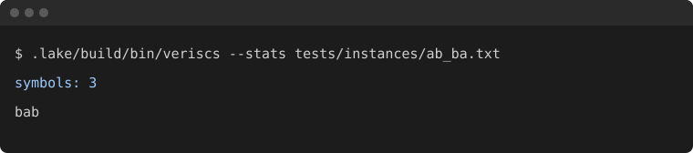

# VeriSCS

[](LICENSE)
[](lean-toolchain)

VeriSCS is the first executable, machine-checked factor-2 reference for the shortest common superstring problem: a shortest string that contains each input string as a contiguous substring. It runs the Lean function `OAI.Superstring.answer` from the public repository [openai/math](https://github.com/openai/math) (Apache-2.0, family 128, commit `adc7f1241b42e322a6451854ab7e4b4c146bf78a`). A polynomial-time factor of 2 has been open for this problem since Tarhio and Ukkonen (1988). Published approximation algorithms stayed strictly above 2; the formalized algorithm is a different procedure, with the ratio checked in Lean. This repository is an independent packaging of that function. It is not affiliated with, and is not endorsed by, the authors of openai/math.

## Example

`tests/instances/ab_ba.txt` is two lines, `ab` and `ba`. On 2026-10-07 the executable exited 0, wrote `symbols: 3` to standard error, and wrote this superstring to standard output:

```text
bab
```

`bab` contains both inputs. The exact optimum also has length 3, so this output meets the optimum. In the measured suite the same instance took 0.1022 seconds. The picture below is that command's real output, not a mock-up.



A second tiny instance, `ab` and `bc`, prints `abcc` (symbol length 4). The optimum is `abc`, length 3. The result is a valid superstring and is not optimal. The benchmark row is 0.1520 seconds.

## Status and limitations

This is a verified reference and a test oracle. It is very slow, and it is not a production superstring tool.

The numbers below are from one machine (`nproc` 4, 16 GiB `MemTotal`) and one binary (170,135,016 bytes). They are measurements, not a fitted curve. The full table is [BENCHMARK.md](BENCHMARK.md). Every finished output covered its inputs. On every row, including the timeout, the separate greedy merge matched the exact dynamic program. The verified executable was longer than that optimum on several rows. Whenever it finished, its length was at most twice the optimum. The largest ratio in the table is 1.667.

| instance | what it is | veriscs length | seconds | RSS KiB | optimum | ratio |
|---|---|---:|---:|---:|---:|---:|
| `ab_ba` | `ab`, `ba` | 3 | 0.1022 | 87284 | 3 | 1.000 |
| `ab_bc` | `ab`, `bc` | 4 | 0.1520 | 87924 | 3 | 1.333 |
| `pair_L8` | `abababab`, `babababa` | 15 | 28.1451 | 88064 | 9 | 1.667 |
| `words_4` | four strings `xay` … `xdy` | 16 | 19.6574 | 87328 | 12 | 1.333 |
| `words_5` | five strings `xay` … `xey` | — | 30.0651 | 87624 | 15 | timeout |

Two strings of length 8 already take 28.1 seconds. Five strings of length 3 did not finish in 30 seconds. Resident set on these runs stayed near 88,000 KiB. The first native build, dominated by compiling Mathlib's C code, took 61 minutes 24 seconds and left `.lake` at 8.6 GiB. Details are in [BUILD.md](BUILD.md).

The Python checker tests containment and length. It does not test the factor-2 bound. Greedy matching the optimum on this suite is a fact about these instances, not a theorem about the greedy algorithm.

## Trust model

The Lean theorem is about the function `answer`, which is defined as `Executable.solve`. For every instance it returns a common superstring whose length, in symbols, is at most twice `opt`. A second theorem says that function has a polynomial-time multi-tape Turing machine implementation. `#print axioms` on `answer`, `answer_spec`, `answer_implementation`, and `main` lists `propext`, `Classical.choice`, and `Quot.sound`.

That does not make the native binary a verified compiler artifact. The text codec in `VeriSCS/CLI.lean` is outside the proof. Whether `IsCommonSuperstring` and `opt` are the problem you mean is a human reading of `Model.lean`. The Comparator transcript accepted the existential statement; the run used a stand-in for landlock. [TRUST.md](TRUST.md) is the full account, including the axiom printout and the tool commits.

## Quick start

There is no GitHub Actions workflow. [elan](https://github.com/leanprover/elan) must be on `PATH` (`~/.elan/bin`). The toolchain is Lean `v4.34.1`. mathlib is pinned at `d13f23b723b8a846827a245b89c10fc7d3f11612`. The checker needs Python 3.11 or later and uses only the standard library.

```sh
make deps      # once: pinned mathlib and its olean cache
make build     # .lake/build/bin/veriscs
make axioms    # #print axioms
make test      # Python unit tests; no Lean binary
make check     # small fixtures, then tools/checker.py
make bench     # runtime, memory, greedy, exact optimum; writes BENCHMARK.md
```

Input is one string per line. A final newline does not add an empty string. Empty lines in the middle are empty strings, and the empty string is a substring of every string.

```sh
.lake/build/bin/veriscs --stats tests/instances/ab_ba.txt
python3 tools/checker.py tests/instances/ab_ba.txt -
```

`--roundtrip` encodes and decodes the input and does not call `answer`. `--stats` writes `symbols: N` to standard error. Each Unicode scalar becomes one Lean symbol, 21 bits, most significant bit first, so the symbol length is the number of code points.

## Benchmark

`make bench` uses a 30 second limit per call. A timeout stops only the rest of that family. The table in [Status and limitations](#status-and-limitations) is the part a first reading needs. [BENCHMARK.md](BENCHMARK.md) has every row, including the one-symbol and distinct-letter instances that finished in well under a second.

`tools/scs.py` holds the two baselines. `greedy_superstring` repeatedly merges the pair with the largest prefix-suffix overlap, breaking ties by the smallest left index and then the smallest right index. `exact_superstring` drops strings already contained in another input, keeps one copy of a duplicate, and solves the overlap path by subset dynamic programming. It refuses more than 20 strings after that filter.

## How to help

The slowdown is the list-based Lean program, not an accident of the benchmark harness. The proof stays attached to a faster program only if that program is proved equivalent to `Executable.solve`. An `Array` implementation with that equivalence is the concrete target. A faster unverified port is useful as a baseline and does not inherit the factor-2 theorem; label it as such.

Also useful: more benchmark instances, with the command and the measured output written down, and a careful reading of `IsCommonSuperstring` and `opt` against the classical problem. [CONTRIBUTING.md](CONTRIBUTING.md) has the local checks. There is no CI to satisfy.

## Credits

The vendored Lean sources are from [openai/math](https://github.com/openai/math) at the commit above, under the Apache License 2.0. `NOTICE` lists them. The upstream scope note, copied in [`vendor/comparator/scope-128.md`](vendor/comparator/scope-128.md), describes one deterministic polynomial-time algorithm whose output is a common superstring of length at most twice the unrestricted optimum, with the ratio in symbols and the time bound in input bits. The manuscript it points to is titled "A Polynomial-Time 2-Approximation for Shortest Common Superstring." Using the repository name here identifies the source of those files. It is not a product name and it is not an endorsement.

Prior work on the approximation ratio, checked against the sources named below for this README:

- Jorma Tarhio and Esko Ukkonen, "A greedy approximation algorithm for constructing shortest common superstrings," *Theoretical Computer Science* 57 (1988), 131–145. [doi:10.1016/0304-3975(88)90167-3](https://doi.org/10.1016/0304-3975(88)90167-3). They study the greedy merge. The greedy conjecture, as later papers state it, is that this algorithm is a 2-approximation. Englert, Matsakis, and Veselý (below) attribute that conjecture to this paper. It is a statement about greedy, not a proof that some other polynomial algorithm achieves 2, and not a proof that none does.
- Marcin Mucha, "Lyndon words and short superstrings," SODA 2013, 958–972. [doi:10.1137/1.9781611973105.69](https://doi.org/10.1137/1.9781611973105.69), [arXiv:1205.6787](https://arxiv.org/abs/1205.6787). The paper gives a polynomial algorithm with ratio \(2 + 11/23\).
- Matthias Englert, Nicolaos Matsakis, and Pavel Veselý, "Approximation Guarantees for Shortest Superstrings: Simpler and Better," ISAAC 2023. [doi:10.4230/LIPIcs.ISAAC.2023.29](https://doi.org/10.4230/LIPIcs.ISAAC.2023.29). Their abstract states an algorithm with guarantee \((\sqrt{67}+14)/9 \approx 2.466\), and a greedy upper bound of \((\sqrt{67}+2)/3 \approx 3.396\).
- Nikolai Chukhin, Alexander S. Kulikov, Ivan Mihajlin, and Alexander Smal, "A Tight Cycle-Cover Inequality for Shortest Common Superstring," [arXiv:2609.27921](https://arxiv.org/abs/2609.27921). This is a preprint. Its abstract claims a \(7/3\)-approximation, and that the greedy algorithm is at most a 3-approximation. This repository has not re-proved that paper.
- Hiroki Shibata, "Disproving the Greedy Superstring Conjecture," [arXiv:2609.01365](https://arxiv.org/abs/2609.01365), September 2026. This is a preprint. Its abstract claims that the greedy algorithm has approximation ratio at least \(9/4\), which would refute the greedy conjecture. It does not say that every polynomial algorithm is worse than 2. This repository has not re-proved that paper. The greedy column in [BENCHMARK.md](BENCHMARK.md) matches the exact optimum on the instances that were run; those instances are not a counterexample.

## Layout

| Path | Role |
|---|---|
| `OAI/Computability/Superstring/` | Unmodified upstream sources (51 files, 20,361 lines) |
| `VeriSCS/CLI.lean` | `veriscs` executable |
| `VeriSCS/Axioms.lean` | `#print axioms` for the specification, the implementation theorem, `main`, and `answer` |
| `tools/checker.py` | Independent substring check |
| `tools/scs.py` | Greedy merge and exact dynamic programming |
| `tools/benchmark.py` | Runtime, memory, and ratio measurements |
| `vendor/comparator/` | Unmodified Comparator challenge and scope note |
| `docs/comparator-superstring.log` | Comparator transcript from the measured revision |
| `CITATION.cff` | Citation metadata |

The Lean package does not fetch the rest of openai/math. `OAI.Computability.Superstring.Main` imports only modules under `OAI.Computability.Superstring`, and that chain ends at `import Mathlib`.

## License

Apache-2.0. See [LICENSE](LICENSE), [NOTICE](NOTICE), and [CITATION.cff](CITATION.cff).
